# Project Sprite — Automotive LiDAR Hardware (Rev 1)

Rev 1 of the Georgia Tech VIP Automotive LiDAR hardware, designed in KiCad. Hierarchical "Sprite" platform covering sensing, motion, power, and telemetry for a scanning LiDAR unit.

## Architecture

Top-level sheets in `kicad/SpriteHardware.kicad_sch`:

| Sheet | Contents |
|---|---|
| Interface Board | System interconnect — BNO055 IMU, LControl / MControl motor control, Manual Override, Receiver, USB Hub (`Sheets/InterfaceBoard/`) |
| Motion Platform | Motor drive for the scanning mechanism |
| Power Supply | Board power regulation |
| Scanning Mechanism | LiDAR scanning assembly interface |

## Files

| Path | Contents |
|---|---|
| `kicad/SpriteHardware.kicad_pro` | KiCad project — open this |
| `kicad/SpriteHardware.kicad_sch` | Top-level schematic |
| `kicad/SpriteHardware.kicad_pcb` | Board layout |
| `kicad/Sheets/` | Hierarchical schematic sheets |
| `kicad/Parts/` | Custom symbols, footprints, and 3D models |
| `kicad/Diagram_Libraries/` | Project symbol/footprint libraries |
| `kicad/Gen1.stp` | Mechanical 3D model |
| `kicad/sym-lib-table`, `kicad/fp-lib-table` | Library tables (keep alongside the project) |

## Board render

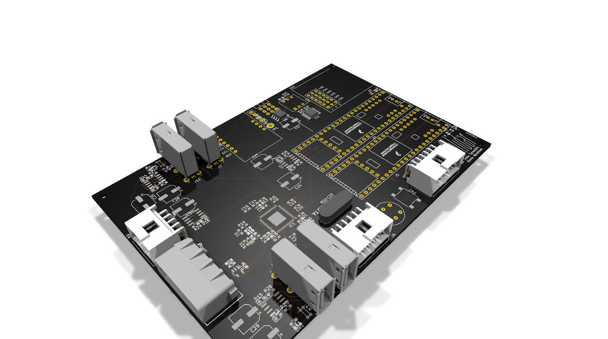

## Schematics

Rendered from the KiCad sources in `kicad/`:

| Sheet | Preview |
|---|---|
| Top level (`SpriteHardware.kicad_sch`) | 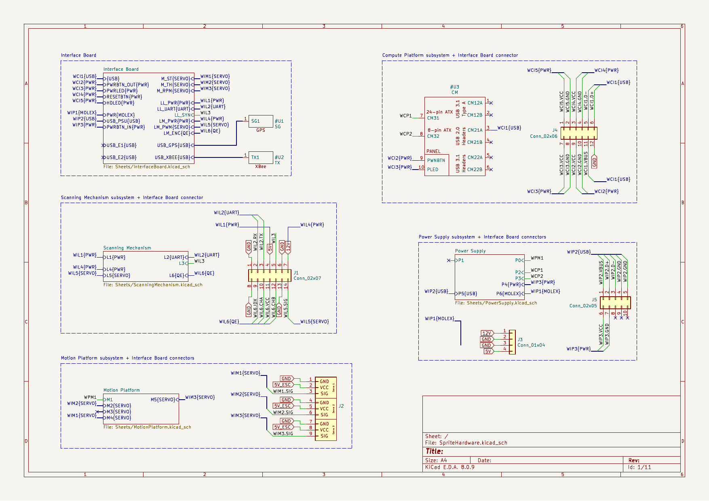 |
| Interface Board | 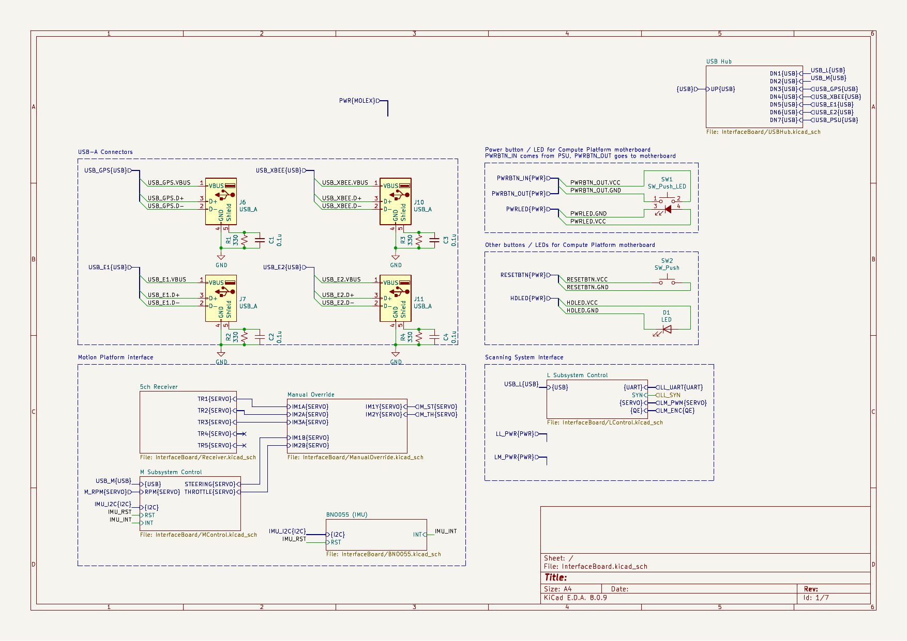 |
| BNO055 IMU | 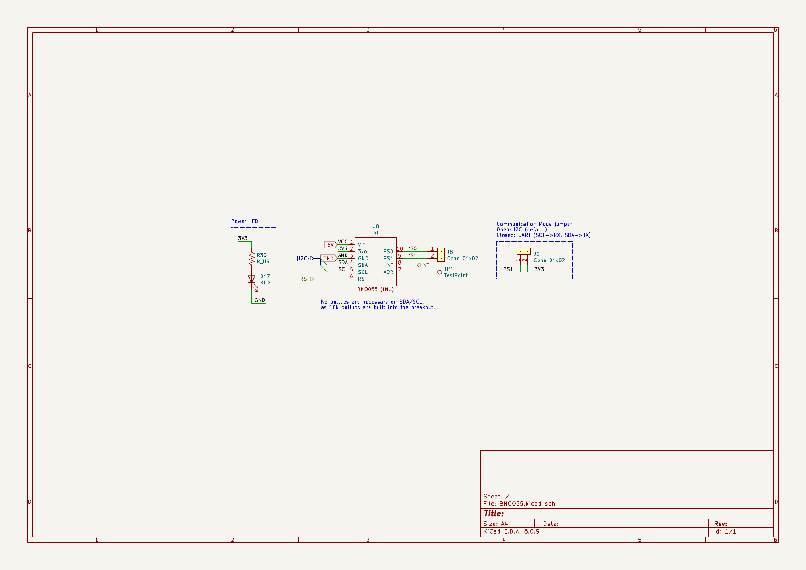 |
| LControl | 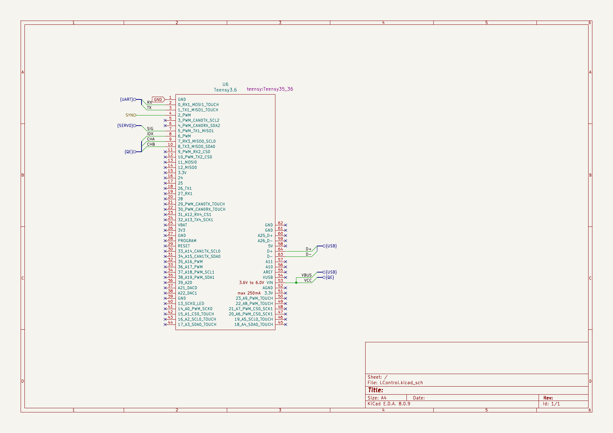 |
| MControl | 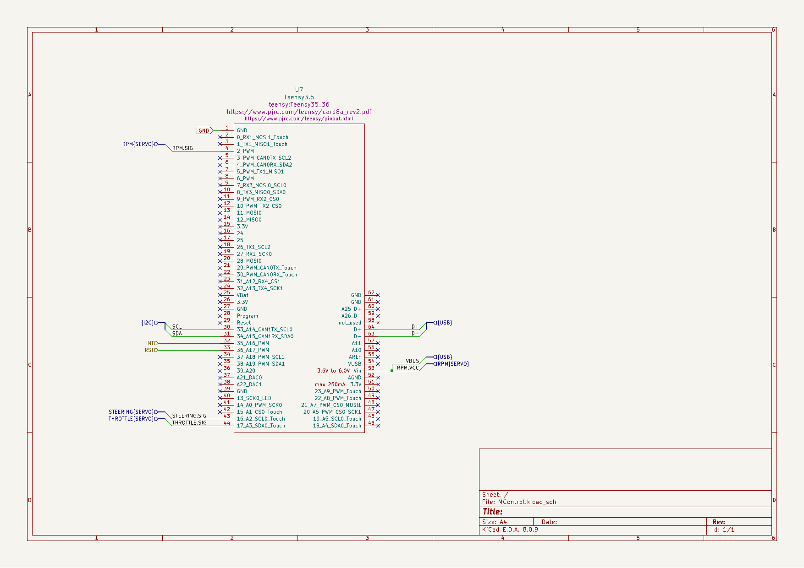 |
| Manual Override | 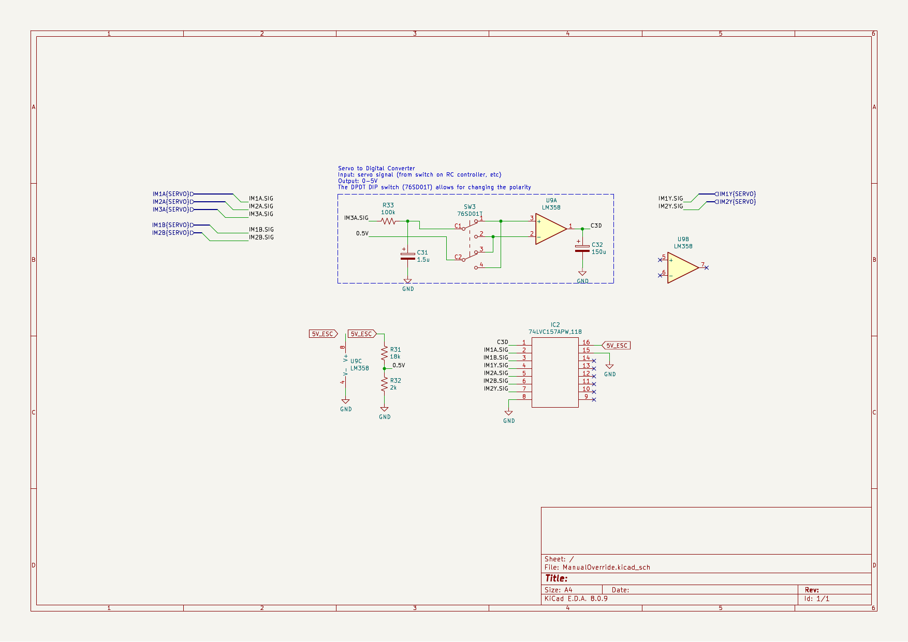 |
| Receiver | 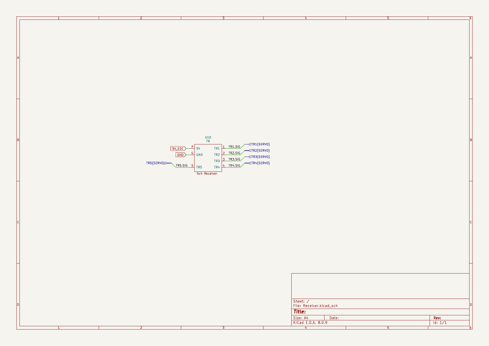 |
| USB Hub | 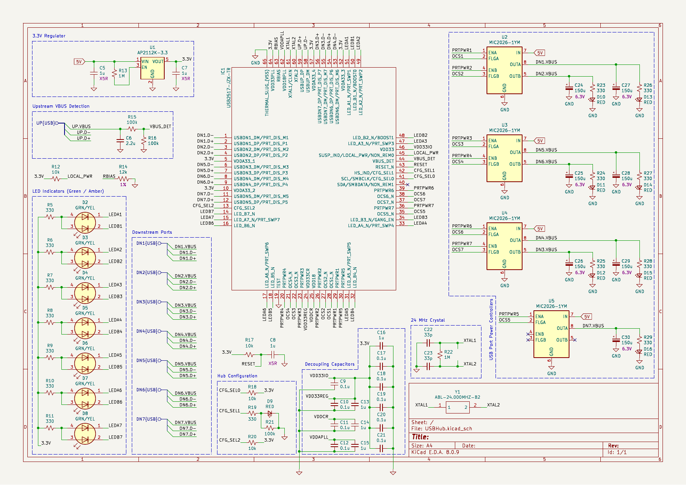 |
| Motion Platform | 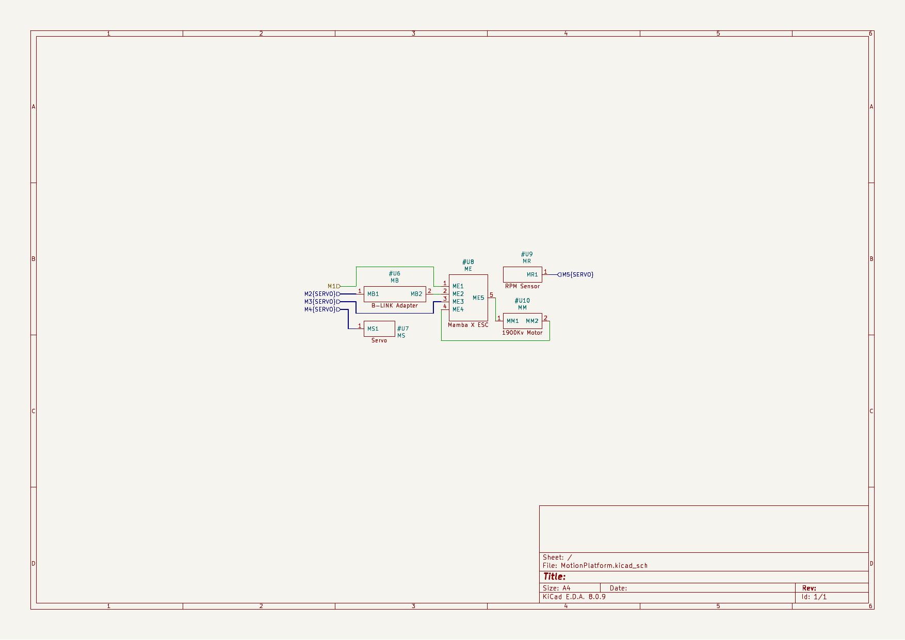 |
| Power Supply | 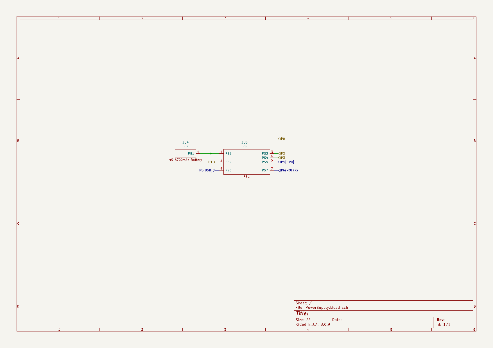 |
| Scanning Mechanism | 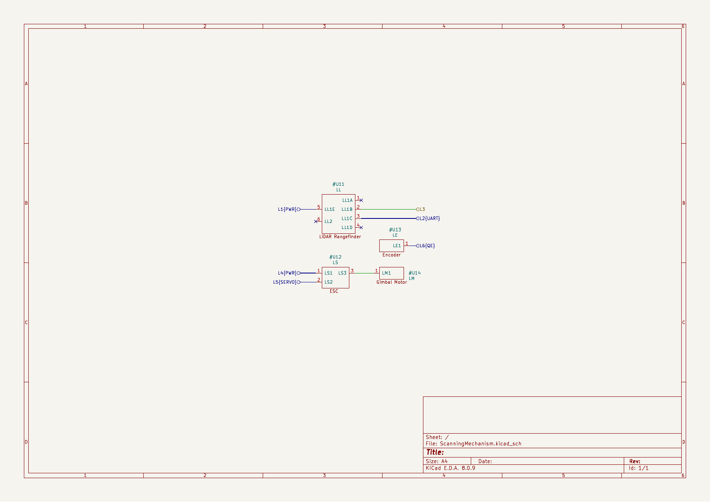 |

## Design notes

- Custom KiCad symbol and footprint libraries under `Parts/` and `Diagram_Libraries/` (Teensy, USB2517 hub, Molex/USB connectors).
- Superseded by [Rev 2](../rev2-vip-spring25/) (Altium redesign) — kept here for design history.
